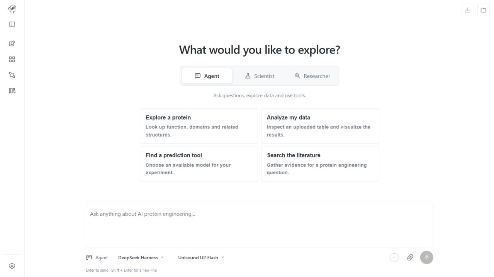
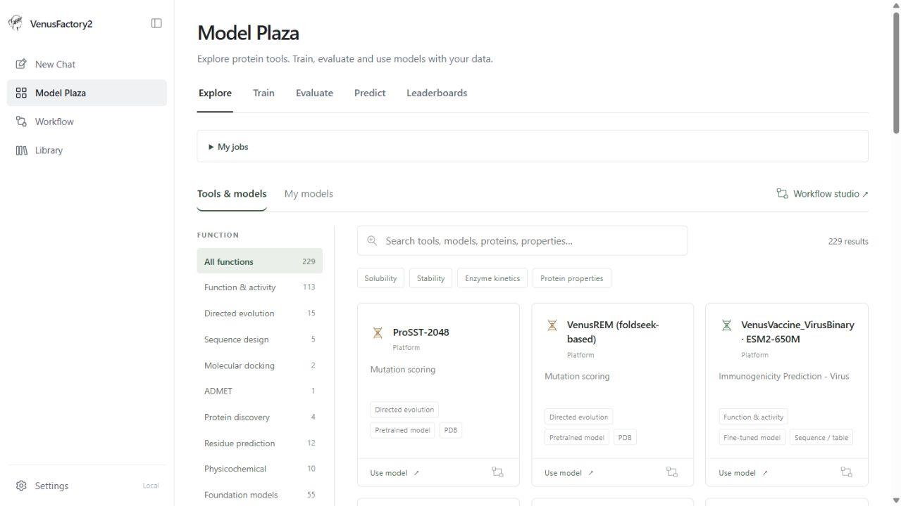

# VenusFactory2

**Recursive Self-improvement AI Agents for Protein Engineering**

[Web server](https://venusfactory.bio/) · [Tutorials](docs/wiki/Home.md) · [Installation](docs/installation.md) · [中文](README_CN.md)

VenusFactory2 brings protein research into a conversational workspace. Ask a
question, upload experimental data, or start with a protein of interest to explore
the literature, run predictions and develop models for your research.

- **Ask and analyse.** Find protein information, use scientific tools and interpret results.
- **Develop from your data.** Turn a research goal and measurements into model code, tests and a research report.
- **Investigate a protein.** Bring literature, database records and predictions together in a report with sources.
- **Reuse the results.** Run models directly, combine tools in a workflow, or request publication of a reviewed Scientist model.



## Start with a question

Click **New Chat**, choose a mode and describe what you want to learn. Agent is
selected by default. You can paste a sequence or attach files, including structures,
measurements and papers.

| Mode | Example request | What you get |
| --- | --- | --- |
| **Agent · Ask and analyse** | “Find homologues of this protein and explain its annotated domains.” | An answer supported by searches, tool results and downloadable files |
| **Scientist · Develop and improve** | “Use my solubility measurements to develop and evaluate a predictor.” | A project with code, test and evaluation results, a report, and model artifacts when trained |
| **Researcher · Investigate a protein** | “Investigate this enzyme, focusing on substrate specificity and engineering opportunities.” | A multi-section report combining literature, protein information and predictions |

To explore first, use Agent's suggested questions or open a **completed example**
in Scientist or Researcher. Completed examples include results you can read and
download without starting a new run. You can also ask Agent how to use the platform;
it reads the same tutorials as the Manual.

### How Scientist works

Scientist uses recursive self-improvement (RSI): it develops a solution, tests it,
uses the feedback to revise the approach, and repeats within the research budget.
A PI (research lead) coordinates the work:

**Goal and data → PI and plan → Develop and experiment ↔ Critique and revise → Review → Deliver**

Follow the plan, intermediate files and progress in the conversation. The final
project and report can be downloaded as a ZIP. A useful result may be a new analysis
tool, a fitted machine-learning model or a method for your experimental setting.
Scientist outputs stay private. To share a model, email its project and test report to
[tanyang.august@sjtu.edu.cn](mailto:tanyang.august@sjtu.edu.cn). The platform operator
selects reviewed models for publication; each published entry displays the author email.
See [operator publication](docs/development/model-publication.md) for local registration.

Scientist delivers a selected model or method with a README, runnable interface,
examples and a test report. Experiments and earlier versions stay in the research
topic; they do not each become another default tool. See the
[Scientist guide](docs/manual/en/scientist.md) for using and downloading results.

## Choose models for your experiment

**Model Plaza** groups models by biological function. Open a model to run a
prediction, or use **Train**, **Evaluate** and **Predict** with your own dataset.
**Workflow** lets you connect tools and follow the data through each step.

| Research task | Example tools and models |
| --- | --- |
| Find related proteins and annotate function | NCBI BLAST, Foldseek, InterProScan |
| Rank mutations | VenusREM, ProSST, ProtSSN |
| Design sequences | ProteinMPNN, LigandMPNN |
| Predict protein properties | ProtSolM, VenusX, VenusVaccine and Factory-trained models |
| Study small molecules | ADMET prediction and Vina docking |
| Build a model for your experiment | Custom model training and reviewed Scientist models |



The catalog brings together established tools, Factory-trained models and reviewed
Scientist contributions. Available tools depend on the installation and administrator
settings; the model page shows what can run.

## Run locally

Use Linux or WSL2 with Git and Python 3.10+ to run the installer; it prepares a
Python 3.12 runtime for the platform. This setup installs the web platform,
built-in search and protein services, and one agent backend:

```bash
git clone --depth 1 https://github.com/ai4protein/VenusFactory2.git
cd VenusFactory2
python3 install_full.py --components harnesses --harnesses deepseek-harness
.venv/bin/python scripts/serve.py --mode local --port 7861
```

Open **http://localhost:7861**. In **Settings → Administration**, configure a
language-model API and enable the tools you need. Use DMXAPI or OpenRouter free
models, or configure your own OpenAI, Claude, Grok, GLM, MiniMax and other provider
APIs in local mode. See [API configuration](docs/model-providers.md). Web search
can use Tavily or SerpAPI; public protein and literature databases are built in.

The installer detects the environment, prepares dependencies and shows download
progress. Model packages and weights can be added later. For example:

```bash
python3 initialize.py install --tools proteinmpnn,ligandmpnn
```

Each runtime gets its own Python environment and model directory. Optional
structure and design runtimes include AlphaFold2, Protenix, Mol-1, RFD4-Proteina,
RFantibody, ESMFold and ESMFold2-Fast, alongside BindCraft and BoltzGen. See the
[runtime guide](docs/model-runtimes.md) for versions, installation and validation.

For a full installation, use `python3 install_full.py`. Some components require a
GPU or a separate license. See the [installation guide](docs/installation.md) for
hardware requirements, component selection and health checks, and the
[service guide](docs/architecture/services.md) for online or multi-process deployment.

For PBS clusters, see [online/local deployment](docs/deployment-pbs.md). The job supervises both services, keeps their data separate and cleans up its processes on exit.

### Online or local?

Use the web server to get started without installation. Run locally when you need
your own datasets, a larger training model or additional compute-intensive tools.
The two modes share the same interface.

| | Online | Local |
| --- | --- | --- |
| Conversations | Shared daily allowance across all three modes | Your own API and resource settings |
| File uploads | Up to 10 MB per file | No platform file-size limit |
| Custom model training | ESM2 8M | Installed models and available hardware |
| Library | Unavailable | Browse uploaded and generated files |

## Learn more

- [Tutorials and examples](docs/wiki/Home.md): Chat, Model Plaza, Workflow and working with your data.
- [Installation](docs/installation.md): add models, weights and agent backends as needed.
- [Developer guide](docs/development.md): repository layout, model integration, services and checks.

## License and citation

VenusFactory2 is available for non-commercial use under the [project license](LICENSE).
Individual tools and models retain their own licenses. Please use the
[published citations](docs/CITATION.md) when referring to the platform and its methods.
For questions, contact [tanyang.august@sjtu.edu.cn](mailto:tanyang.august@sjtu.edu.cn).
