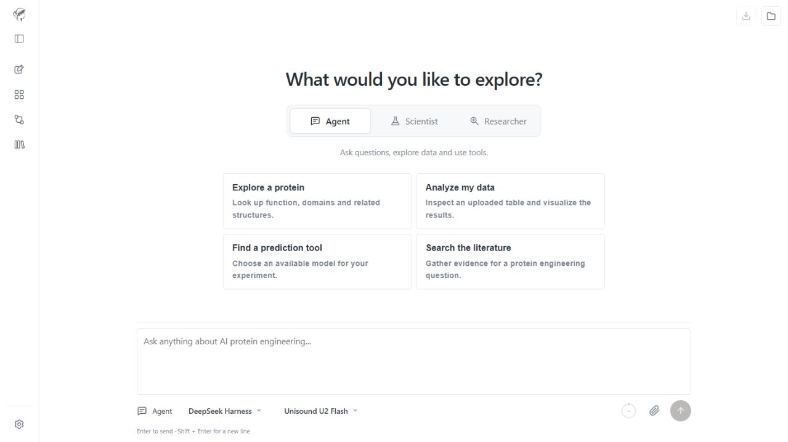
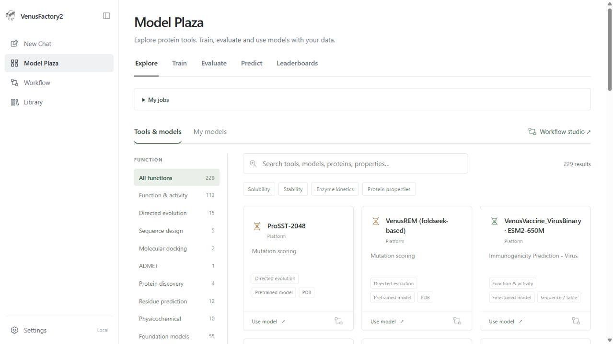

# VenusFactory2

**Recursive Self-improvement AI Agents for Protein Engineering**

[在线平台](https://venusfactory.bio/) · [使用教程](docs/wiki/Home.md) · [安装指南](docs/installation.zh-CN.md) · [English](README.md)

VenusFactory2 是面向蛋白质研究的对话式工作平台。从一个问题、一份实验数据或一个
感兴趣的蛋白出发，检索文献、调用预测工具，并开发适合自己研究的模型。

- **提问与分析**：查询蛋白信息、调用科学工具、理解预测结果。
- **从数据开发模型**：围绕研究目标和实验测量，产出模型代码、测试结果与研究报告。
- **全面研究一个蛋白**：整合文献、数据库信息和预测，生成带来源的专题报告。
- **浏览研究案例**：在 RSI 广场预览 Scientist 项目、阅读报告并下载可复现的代码。



## 从一个问题开始

点击 **New Chat**，选择模式，描述你想解决的问题。默认进入 Agent；可以粘贴序列，
也可以上传结构、实验测量、论文等材料。

| 模式 | 示例问题 | 可以获得什么 |
| --- | --- | --- |
| **Agent · 提问与分析** | “查找这个蛋白的同源序列，并解释它的结构域注释。” | 结合检索和工具结果的回答、预测结果及可下载文件 |
| **Scientist · 开发与改进** | “根据我的溶解度测量，开发并评估一个预测模型。” | 包含代码、测试与评估结果、报告的项目，以及训练产出的模型文件 |
| **Researcher · 蛋白专题研究** | “全面调研这个酶，重点关注底物特异性和改造方向。” | 整合文献、蛋白信息和预测的多章节报告 |

想先体验，可以使用 Agent 的推荐问题，或打开 Scientist、Researcher 的**已完成样例**。
样例提供可直接阅读和下载的结果，无需重新运行。操作时遇到疑问，也可以直接问 Agent；
它会查阅与 Manual 相同的使用教程。

### Scientist 怎样开展研究？

Scientist 采用递归自我改进（RSI）：开发方案、执行测试，再根据反馈修改方法，
在给定预算内反复迭代。PI（研究负责人）协调各个环节：

**目标与数据 → PI 与计划 → 开发和实验 ↔ 评议与修订 → 审核 → 交付**

在对话中可以跟踪计划、阶段进展和中间文件，最终将项目与报告打包下载为 ZIP。
研究成果可以是新的分析工具、训练好的机器学习模型，或适合特定实验场景的方法。
经过筛选发布的成果在模型广场下的 **RSI 广场**展示案例仓库和 ZIP 下载。RSI 模型不接入 Agent 或 Researcher 工具。

## 为实验选择合适的模型

**Model Plaza（模型广场）**按生物学功能分类。打开模型即可进行预测，也可以通过
**Train、Evaluate、Predict** 使用自己的数据。进入 **RSI 广场**，可阅读研究项目的
README、代码和报告，并下载完整项目 ZIP。

| 研究任务 | 工具与模型示例 |
| --- | --- |
| 查找相关蛋白、注释功能 | NCBI BLAST、Foldseek、InterProScan |
| 筛选候选突变 | VenusREM、ProSST、ProtSSN |
| 设计蛋白序列 | ProteinMPNN、LigandMPNN |
| 预测蛋白性质 | ProtSolM、VenusX、VenusVaccine 与 Factory 训练模型 |
| 分析小分子 | ADMET 预测、Vina 对接 |
| 针对自己的实验建立模型 | 自定义模型训练、通过审核的 Scientist 模型 |



模型广场提供已有工具和 Factory 训练模型；RSI 广场单独展示 Scientist 案例成果。
可运行的工具取决于已安装组件和管理员设置，可以在模型页面查看。

## 本地运行

准备 Linux 或 WSL2、Git 和 Python 3.10+ 来运行安装器；安装器会为平台准备 Python 3.12
运行环境。以下命令安装网页平台、自带的检索与蛋白服务，以及一个智能体执行后端：

```bash
git clone --depth 1 https://github.com/ai4protein/VenusFactory2.git
cd VenusFactory2
python3 install_full.py --components harnesses --harnesses deepseek-harness
.venv/bin/python scripts/serve.py --mode local --port 7861
```

打开 **http://localhost:7861**，在 **Settings → Administration** 中配置大模型 API，
并启用需要的工具。支持 DMXAPI 和 OpenRouter 免费模型；本地还可以配置自己的
OpenAI、Claude、Grok、GLM、MiniMax 等 API，见 [API 配置](docs/model-providers.md)。
网络检索支持 Tavily 或 SerpAPI，公共蛋白与文献数据库查询为平台自带能力。

安装程序会检测系统、准备环境并显示下载进度。模型软件与权重可以后续按需添加，例如：

```bash
python3 initialize.py install --tools proteinmpnn,ligandmpnn
```

需要完整安装时，运行 `python3 install_full.py`；部分组件需要 GPU 或单独许可。
硬件要求、组件选择和健康检查见[安装指南](docs/installation.zh-CN.md)，线上部署和
多进程启动见[服务指南](docs/architecture/services.md)。

PBS 集群部署见[online/local 启动指南](docs/deployment-pbs.md)：统一管理两种模式的服务，分别保存数据，并在作业退出时清理进程。
本地研究可通过 Scientist CLI 接入 [PBS 或 Slurm 集群](docs/local-clusters.md)，线上模式不提供集群操作。

### 在线使用，还是本地运行？

在线平台无需安装，适合直接体验。本地运行适合使用自己的数据集、更大的训练模型，
或安装计算量较大的工具。两种模式使用相同的界面。

| | 在线 | 本地 |
| --- | --- | --- |
| 对话 | 三种模式共享每日额度 | 使用自己的 API 与资源配置 |
| 上传文件 | 每个文件最多 10 MB | 平台不设文件大小上限 |
| 自定义模型训练 | ESM2 8M | 根据已安装模型和硬件选择 |
| Library（文件库） | 不可用 | 浏览上传文件和计算产物 |

## 继续了解

- [使用教程与样例](docs/wiki/Home.md)：Chat、模型广场、RSI 广场和自定义数据。
- [安装指南](docs/installation.zh-CN.md)：按需添加模型、权重和智能体执行后端。
- [开发者指南](docs/development.md)：目录规范、模型接入、服务启动与检查。

## 许可与引用

VenusFactory2 按[项目许可证](LICENSE_CN.md)提供非商业使用。各工具和模型保留各自的
许可证。引用平台或相关方法时，请使用[已发表论文信息](docs/CITATION.md)。
有问题可联系 [tanyang.august@sjtu.edu.cn](mailto:tanyang.august@sjtu.edu.cn)。
