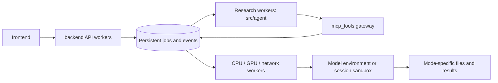

# Services, storage and operations

## Repository boundaries

```text
frontend/              React UI, shared by online and local
backend/               FastAPI + web_v2 sessions, policy, jobs, workers, downloads
mcp_tools/             MCP gateway, scheduler and model/service packages
src/agent/             Agent harnesses, Scientist RSI and research logic
src/                   Shared ML code, configuration and legacy CLI adapters
configs/               Runtime templates, harness profiles and research protocols
scripts/               Service launch, installation, verification and research scripts
tests/                 Offline regression checks and integration fixtures
docs/manual/           User tutorial source, shared with wiki and Agent lookup
docs/architecture/     Developer and operations documentation
runtime/local/         Local state, files, models, queues and research runs
runtime/online/        Online state, files, models, queues and research runs
research_runs/         Historical experimental evidence, not production state
src/agent/skills/vendor/  Optional upstream skill submodule, separate from native skills
```

Imports use `backend.web_v2`, `mcp_tools.models`, `mcp_tools.tools` and
`mcp_tools.scheduler`. The canonical service launcher is `scripts/serve.py`.
Model implementations are split by origin; see [model integration](model-integration.md).
Model profiles and launcher paths resolve relative to the repository root;
external administrator-managed installations may use absolute paths.
Do not move historical experiment data or checkpoints during a code refactor.
`src/agent/harness/_legacy_*` contains hash-verified historical audit capsules.
Their bytes remain unchanged; they are not the current service implementation.

## Build and start

Use Linux for worker queues and Bubblewrap isolation. Activate the installed
Python environment, configure `.env`, and build the shared frontend:

```bash
cd frontend
npm ci
npm run build
cd ..
python scripts/serve.py --mode local --port 7861
```

This serves the frontend and API, starts an independent MCP process when needed,
and starts fixed worker pools when jobs arrive. Closing the browser or restarting
the API does not stop independent jobs.

For separate terminals or service-manager units (same Python environment):

```bash
# Terminal 1: independent loopback MCP service
python scripts/serve.py --mode local --component mcp --mcp-port 8080
# Terminal 2: API + built frontend, two Uvicorn processes
python scripts/serve.py --mode local --component api --mcp-port 8080 --port 7861 --api-workers 2
# Optional terminal 3: ensure pools for persisted queued jobs
python scripts/serve.py --mode local --component workers --mcp-port 8080
```

Worker auto-start is on by default. For service-managed workers, set
`VENUS_WORKER_AUTOSTART=0` consistently for API and MCP and run the workers
command. It starts fixed research/CPU/GPU/network pools for queued configuration
namespaces. It does not create a waiting process for every queued job. Each
worker supervises one task subprocess at a time. Worker supervisors survive the
launcher; manage them through your service manager and drain running tasks before
stopping a deployment.

Run online separately, with its own runtime directory and MCP port:

```bash
python scripts/serve.py --mode online --port 7863 --mcp-port 8081 --api-workers 2
python scripts/serve.py --mode online --check
```

Local and online use the same `frontend/dist` by default. Only policy differs:
online quota, 10 MB uploads, free models, restricted Scientist budget, ESM2 8M
training and disabled expensive tools. Explicit legacy path overrides in `.env`
are respected: check effective paths with `--check` and never point two modes at
the same session/queue/database directories. Reverse-proxy only the API; keep MCP
private. Set trusted proxy configuration explicitly when deploying publicly.

The current single-host task store is SQLite WAL with process-safe claims and
leases. `--api-workers` adds API processes, not GPU replicas. This is not yet a
distributed PostgreSQL/Redis cluster; do not share SQLite across network hosts.

## Jobs and resource limits



The queue belongs to the backend's shared persistence layer; MCP uses that same
queue library instead of creating a second scheduler. Model inference and weight loading run in task workers; increasing the API
worker count should not create extra model replicas. Scientific adapter code lives in
`mcp_tools/models/` and `mcp_tools/tools/`; installed software and weights live outside source folders.
The name `runtime/` refers to deployment state; `mcp_tools/scheduler/` is the
Python implementation of task submission and execution, so these are distinct.

`session_id` identifies a conversation, `run_id` an execution, and a tool child
has its own job ID. API admission checks ownership, quota and idempotency; jobs,
events and checkpoints are saved before execution. MCP accepts submit/query/
cancel requests. Child jobs inherit parent cancellation. Training and prediction
run outside the request process. Long orchestration waits do not hold a GPU slot.

| Environment setting | Default | Purpose |
| --- | --- | --- |
| `VENUS_WORKERS_RESEARCH` | 2 | Research worker processes per configuration pool |
| `VENUS_WORKERS_CPU` | 2 | CPU worker processes per pool |
| `VENUS_WORKERS_GPU` | 1 | GPU worker processes per pool |
| `VENUS_WORKERS_API` | 4 | Network/coordinator workers per pool |
| `VENUS_QUEUE_RESEARCH_SLOTS` | 2 | Research concurrency in the shared queue |
| `VENUS_QUEUE_CPU_SLOTS` | 2 | CPU concurrency |
| `VENUS_QUEUE_GPU_SLOTS` | 1 | GPU concurrency |
| `VENUS_QUEUE_API_SLOTS` | 2 | Concurrency per external-service resource |
| `VENUS_QUEUE_MAX_PENDING` | 256 | Total pending jobs |
| `VENUS_QUEUE_MAX_PENDING_PER_OWNER` | 32 | Pending jobs per owner |

Failed workers are marked interrupted and retain checkpoints. Recovery is an
explicit resume/retry; arbitrary code and external side effects are not silently
replayed. Budget exhaustion or waiting for measurements is not research success.
Changing credentials/configuration may create a new pool namespace; queue limits
still apply across pools. Both deployments can compete for the same physical
GPU, so budget their GPU slots together or assign separate devices.

## Scientist deliverables

Scientist generates a project workspace with source, dependency declarations,
training/inference entry points, tests, fitted models and reports when the
research supports them. The UI exports:

```text
README.md
REPORT.md
research/              Plan, usage, development and admission evidence
project/               Authored workspace, preserving directory structure
checksums.json         SHA-256 manifest
```

Pause a running study before creating its ZIP. Incomplete studies can export
their evidence without being labelled successful. Export access is bound to
the owning conversation; worker configuration, credentials, other conversations
and filesystem links are excluded. Public model registration still requires
the separate reproducibility and independent review gates.

## Diagnosis and verification

Use the admin task/usage pages and the deployment's `runtime/<mode>/queue/`
logs. Scientist evidence lives in `runtime/<mode>/scientist/`; API and MCP must
share the same MCP port, signing-key directory, queue and mode configuration.
Many immediate tool failures across unrelated databases usually indicate a
local transport/configuration problem; inspect that before blaming data sources.

```bash
python scripts/check_layout.py
python scripts/sync_platform_docs.py --check
PYTHONPATH=src python -m pytest -q tests/test_research_project_delivery.py tests/test_external_mcp_dispatch.py tests/test_tool_runtime.py tests/test_durable_tasks.py
cd frontend
npm run build
```

Back up each mode's SQLite databases consistently and retain files/checkpoints
together. Before upgrades, check active jobs, publish one frontend build to both
modes, restart idle API/MCP processes, then verify a real queued tool call and a
Scientist project download. Do not rewrite prior experimental results.

## Retired interfaces and shared calculation code

The ignored local `archive/` preserves old notebooks, Gradio UI and FRPC utilities; these are absent from source releases. Current services
never import it. Shared path/data/report functions are in `mcp_tools/common/`;
model implementations are in `mcp_tools/models/{pretrained,factory,evolved}/`; non-model services remain in `mcp_tools/tools/`.
`mcp_tools/models/` starts model-specific environments on demand; it does not
create a permanently running server for each model. See `docs/model-runtimes.md`.
