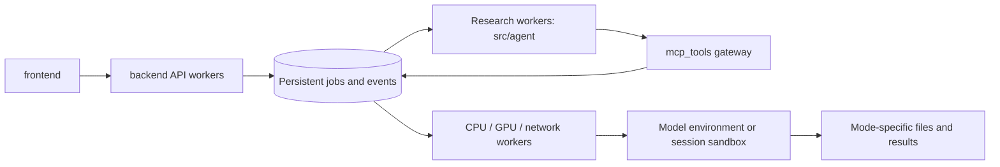

# Services, storage and operations

## Repository boundaries

```text
frontend/              React UI, shared by online and local
backend/               FastAPI + web_v2 sessions, policy, jobs, workers, downloads
mcp_tools/             MCP gateway, scheduler and model/service packages
src/agent/             Agent harnesses, Scientist RSI and research logic
src/                   Shared ML code, configuration and legacy CLI adapters
configs/               Runtime templates, harness profiles and research protocols
scripts/               Service launch, installation, verification and research scripts
tests/                 Offline regression checks and integration fixtures
docs/manual/           User tutorial source, shared with wiki and Agent lookup
docs/architecture/     Developer and operations documentation
runtime/local/         Local state, files, models, queues and research runs
runtime/online/        Online state, files, models, queues and research runs
research_runs/         Historical experimental evidence, not production state
src/agent/skills/vendor/  Optional upstream skill submodule, separate from native skills
```

Imports use `backend.web_v2`, `mcp_tools.models`, `mcp_tools.tools` and
`mcp_tools.scheduler`. The canonical service launcher is `scripts/serve.py`.
Model implementations are split by origin; see [model integration](model-integration.md).
Model profiles and launcher paths resolve relative to the repository root;
external administrator-managed installations may use absolute paths.
Do not move historical experiment data or checkpoints during a code refactor.
`src/agent/harness/_legacy_*` contains hash-verified historical audit capsules.
Their bytes remain unchanged; they are not the current service implementation.

## Optional online website analytics

Set `WEBUI_V2_GA_MEASUREMENT_ID` in `.env` to the Google Analytics 4 web
stream measurement ID (`G-...`). The same setting appears in **Administration
> Environment**. This is a public identifier, not an API secret. Leave it empty
to disable Google Analytics. Restart the API and reload the browser after changes;
the shared frontend does not need rebuilding when the ID changes.

Only online mode exposes the ID and loads Google's asynchronous tag. Local mode
does not load it, even when both services share the same `.env`. Missing or
invalid IDs disable tracking without affecting the app. An unavailable or blocked
Google script does not prevent the interface from working.

The tag is initialized once per document, including React remounts and language
changes. SPA page views use Google's **Enhanced measurement > Page views > Page
changes based on browser history events** setting; keep it enabled in the GA web
stream. The app does not also send manual `page_view` events. See
[Google's SPA setup](https://developers.google.com/analytics/devguides/collection/ga4/single-page-applications).
The Google tag collects website usage according to that stream's settings.
This integration adds no custom chat-content, uploaded-file or model-result events.

## Build and start

Use Linux for worker queues and Bubblewrap isolation. Activate the installed
Python environment, configure `.env`, and build the shared frontend:

```bash
cd frontend
npm ci
npm run build
cd ..
python scripts/serve.py --mode local --port 7861
```

This serves the frontend and API, starts an independent MCP process when needed,
and starts fixed worker pools when jobs arrive. Closing the browser or restarting
the API does not stop independent jobs.

For separate terminals or service-manager units (same Python environment):

```bash
# Terminal 1: independent loopback MCP service
python scripts/serve.py --mode local --component mcp --mcp-port 8080
# Terminal 2: API + built frontend, two Uvicorn processes
python scripts/serve.py --mode local --component api --mcp-port 8080 --port 7861 --api-workers 2
# Optional terminal 3: ensure pools for persisted queued jobs
python scripts/serve.py --mode local --component workers --mcp-port 8080
```

Worker auto-start is on by default. For service-managed workers, set
`VENUS_WORKER_AUTOSTART=0` consistently for API and MCP and run the workers
command. It starts fixed research/CPU/GPU/network pools for queued configuration
namespaces. It does not create a waiting process for every queued job. Each
worker supervises one task subprocess at a time. Worker supervisors survive the
launcher; manage them through your service manager and drain running tasks before
stopping a deployment. Automatically started pools exit after 60 seconds with no
queued or running work. The next submission starts a fresh pool. Admission and
retirement share a process lock, so a task cannot arrive unnoticed during exit.
Pools with `VENUS_WORKER_AUTOSTART=0` remain running for service management.

Run online separately, with its own runtime directory and MCP port:

```bash
python scripts/serve.py --mode online --port 7863 --mcp-port 8081 --api-workers 2
python scripts/serve.py --mode online --check
```

Local and online use the same `frontend/dist` by default. Only policy differs:
online quota, 10 MB uploads, free models, restricted Scientist budget, ESM2 8M
training and disabled expensive tools. Explicit legacy path overrides in `.env`
are respected: check effective paths with `--check` and never point two modes at
the same session/queue/database directories. Reverse-proxy only the API; keep MCP
private. Set trusted proxy configuration explicitly when deploying publicly.

Set `VENUS_TRUSTED_PROXIES` to the actual proxy addresses or CIDRs, preserve the
public `Host`, and have the proxy overwrite forwarded headers. API mutations
validate the browser Origin (scheme, host and port); job identity cookies use
Secure on HTTPS, including TLS terminated by a trusted proxy. Direct command-line
clients can omit Origin; authentication and ownership checks still apply.

For a TLS-terminating tunnel that does not forward the protocol, set
`WEBUI_V2_PUBLIC_ORIGIN=https://your-public-domain` and preserve the public Host.
Only that exact host and port use the configured HTTPS scheme; local HTTP access
continues to work. This setting does not trust forwarded client IPs or allow
foreign browser origins. Restart the API after changing deployment settings.

The current single-host task store is SQLite WAL with process-safe claims and
leases. `--api-workers` adds API processes, not GPU replicas. This is not yet a
distributed PostgreSQL/Redis cluster; do not share SQLite across network hosts.

## Jobs and resource limits



The queue belongs to the backend's shared persistence layer; MCP uses that same
queue library instead of creating a second scheduler. Model inference and weight loading run in task workers; increasing the API
worker count should not create extra model replicas. Scientific adapter code lives in
`mcp_tools/models/` and `mcp_tools/tools/`; installed software and weights live outside source folders.
The name `runtime/` refers to deployment state; `mcp_tools/scheduler/` is the
Python implementation of task submission and execution, so these are distinct.

`session_id` identifies a conversation, `run_id` an execution, and a tool child
has its own job ID. API admission checks ownership, quota and idempotency; jobs,
events and checkpoints are saved before execution. MCP accepts submit/query/
cancel requests. Child jobs inherit parent cancellation. Training and prediction
run outside the request process. Long orchestration waits do not hold a GPU slot.

| Environment setting | Default | Purpose |
| --- | --- | --- |
| `VENUS_WORKERS_RESEARCH` | 2 | Research worker processes per configuration pool |
| `VENUS_WORKERS_CPU` | 2 | CPU worker processes per pool |
| `VENUS_WORKERS_GPU` | 1 | GPU worker processes per pool |
| `VENUS_WORKERS_API` | 4 | Network/coordinator workers per pool |
| `VENUS_WORKER_IDLE_TIMEOUT` | 60 | Idle seconds before an automatically started pool exits |
| `VENUS_QUEUE_RESEARCH_SLOTS` | 2 | Research concurrency in the shared queue |
| `VENUS_QUEUE_CPU_SLOTS` | 2 | CPU concurrency |
| `VENUS_QUEUE_GPU_SLOTS` | 1 | GPU concurrency |
| `VENUS_QUEUE_API_SLOTS` | 2 | Concurrency per external-service resource |
| `VENUS_QUEUE_MAX_PENDING` | 256 | Total pending jobs |
| `VENUS_QUEUE_MAX_PENDING_PER_OWNER` | 32 | Pending jobs per owner |

Failed workers are marked interrupted and retain checkpoints. Recovery is an
explicit resume/retry; arbitrary code and external side effects are not silently
replayed. Budget exhaustion or waiting for measurements is not research success.
Changing credentials/configuration may create a new pool namespace; queue limits
still apply across pools. Both deployments can compete for the same physical
GPU, so budget their GPU slots together or assign separate devices.

Large Agent tool observations are saved under the owning session's
`context/tool-observations/` before their working-memory preview is shortened.
The next turn receives separate result and argument excerpts within a 12,000-byte
UTF-8 window, plus the path to the full JSON record under `/workspace`. The saved
record includes the original arguments, output and completion status. Follow-up
questions can retrieve omitted details from that record. Archive writes use the shared
descriptor-anchored file boundary. If a write fails, the observation remains
explicitly excerpted and carries no nonexistent file reference.

## Scientist deliverables

Scientist generates a project workspace with source, dependency declarations,
training/inference entry points, tests, fitted models and reports when the
research supports them. The UI exports:

```text
README.md
REPORT.md
research/              Plan, usage, development and admission evidence
project/               Authored workspace, preserving directory structure
checksums.json         SHA-256 manifest
```

For support/query experiments, validation and independent Review also report a
score with equal weight per protein task, alongside the existing pooled score.
They compare regression predictions with each task's support mean and median
(classification uses support majority). These comparisons appear in the model
report and introduce no automatic superiority requirement. Query labels remain
in host storage; aggregate metrics enter the research record.

Pause a running study before creating its ZIP. Incomplete studies can export
their evidence without being labelled successful. Export access is bound to
the owning conversation; worker configuration, credentials, other conversations
and filesystem links are excluded. Public model registration still requires
the separate reproducibility and independent review gates.

## Diagnosis and verification

Use the admin task/usage pages and the deployment's `runtime/<mode>/queue/`
logs. Scientist evidence lives in `runtime/<mode>/scientist/`; API and MCP must
share the same MCP port, signing-key directory, queue and mode configuration.
Many immediate tool failures across unrelated databases usually indicate a
local transport/configuration problem; inspect that before blaming data sources.

```bash
python scripts/check_layout.py
python scripts/check_repository.py
python scripts/sync_platform_docs.py --check
PYTHONPATH=src python -m pytest -q tests/test_http_security.py tests/test_worker_lifecycle.py tests/test_repository_state_exclusions.py
PYTHONPATH=src python -m pytest -q tests/test_research_project_delivery.py tests/test_external_mcp_dispatch.py tests/test_tool_runtime.py tests/test_durable_tasks.py
cd frontend
npm run build
```

Back up each mode's SQLite databases consistently and retain files/checkpoints
together. Keep the running service checkout unchanged: develop and test in a separate
worktree, then deploy a coherent revision and restart idle API/MCP processes. Python
processes cache imported modules; updating source underneath them can mix old loaded
modules with newly imported files even while `/health` still returns success.

Before upgrades, check active jobs and publish one frontend build to both modes.
The bundled launcher (`scripts/deploy_services.py`) checks Agent and Scientist
configuration catalogs as well as API/MCP health before starting its tunnel. Empty
catalogs are permitted for a fresh installation without configured API keys; broken
or malformed catalogs are not ready. These startup checks make no LLM requests.
The private `runtime/services/deployment.json` records the startup time, Git
revision, dirty state and frontend index digest. Use that startup record rather than
assuming the current checkout revision is what an existing process has loaded.
Source archives without Git metadata are supported; their revision remains unknown.
The Agent model picker has a bounded configuration request and an explicit retry
when loading fails; changing pages cancels the request. It does not poll the catalog.
CI runs the deployment-readiness, shared-runtime-discovery and frontend recovery tests.

After deployment, verify a real queued tool call and a Scientist project download.
Do not rewrite prior experimental results.

## Retired interfaces and shared calculation code

The ignored local `archive/` preserves old notebooks, Gradio UI and FRPC utilities; these are absent from source releases. Current services
never import it. Shared path/data/report functions are in `mcp_tools/common/`;
model implementations are in `mcp_tools/models/{pretrained,factory,evolved}/`; non-model services remain in `mcp_tools/tools/`.
`mcp_tools/models/` starts model-specific environments on demand; it does not
create a permanently running server for each model. See `docs/model-runtimes.md`.


## Visitor recovery and feedback allowances

Online conversation ownership uses the persistent HttpOnly visitor cookie. Existing
admitted conversations are recovered through their quota records even if the IP,
browser version or UI cache changes. Clearing that cookie removes the browser's proof
of ownership. Local deployment remains unrestricted.

Extra allowance (Feedback) opens a prefilled email to tanyang.august@sjtu.edu.cn
with bug reports or suggestions and separate daily chat and prediction requests.
The applicant sends it from their email app; the platform does not collect feedback
requests in its database or administration interface. Administrators review the email,
set both amounts under Quota keys and return the generated key to the applicant.
Sending a request does not award credits automatically. Activated prediction grants apply across Chat, Model Plaza and
Workflow and share their daily allowance across devices. Rotation, expiry and revocation
invalidate the old binding.

Administration shows browser visitor counts, recent visits, each mode's starts, LLM/tool
calls, reported tokens and quota usage. Visitors are browser identities, not verified
people; visit recording begins with this release. Reset all allowances restores the
current deployment's daily chat, prediction and Workflow allowances after confirmation.
It preserves historical admissions, conversation ownership, idempotency, running tasks,
grant keys and IP burst protection, and writes an administrator audit event.
