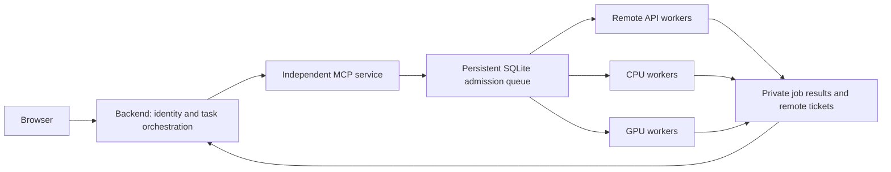

# Scientific tool runtime

The browser talks to the backend. The backend owns session access, request
budgets and online-mode policy. Shared scientific computation is submitted over
MCP to an independent loopback service, which dispatches persistent queued jobs.
Neither the browser nor a language model chooses a job owner or queue resource.



## Functional categories

| Category | Examples | Resource |
|---|---|---|
| Web and literature | Tavily, SerpAPI, PubMed, arXiv, OpenAlex | API |
| Protein databases | NCBI Entrez, gget, UniProt, RCSB, BRENDA, ChEMBL, KEGG, STRING | API |
| Remote analyses | NCBI BLAST, remote Foldseek, InterPro, Clustal Omega, MMseqs2 | API |
| Sequence calculations | FASTA parsing, physicochemical properties, translation | CPU |
| Structure calculations | SASA, RSA, secondary structure, superposition | CPU |
| Prediction and design | Function/residue prediction, ESMFold, ProteinMPNN, registered RSI models | GPU admission by default |
| Training and development | Training configuration, model training, generated development code | GPU for training; CPU for preparation |
| Files and capabilities | File operations, skill/model discovery, registration | CPU; lightweight discovery is inline |

The canonical catalog is `tool_runtime.catalog`. Both discovery results and
`GET /api/tools/catalog` include the category, input schema, resource and online
availability. Tool metadata can declare `tool_category`, `queue_resource` and
`timeout_seconds`. Unknown tools cannot execute merely by appearing in a request.
Legacy MCP aliases keep their existing names and argument schemas.

## Process and API boundaries

* `/mcp`: the scientific tool protocol used by Kimi and other MCP clients.
  A compatibility middleware queues execution and waits for its result. Existing
  clients still receive their original MCP content blocks and structured output.
* `/scheduler/mcp`: internal backend control plane. Its tools submit, list, read
  and cancel asynchronous jobs. A private service credential is required; it is
  stored with mode 0600 in the queue control directory, never sent to the browser.
* `POST /api/tools/jobs`: returns **202**, a `VF-...` job number, job ID, status
  and queue position. This generic browser endpoint admits the public query tools.
  Model training, inference and code execution retain their purpose-built forms
  and session harness authorization.
* `GET /api/tools/jobs`, `GET /api/tools/jobs/{id}` and
  `POST /api/tools/jobs/{id}/cancel`: only the submitting browser/session can
  inspect or cancel a job. A job number is not a credential. For a chat job,
  provide the existing `session_id` and session access header.

Native Codex, Claude Code and DeepSeek harness bridges submit registered shared
tools through this MCP service. Session-bound file/plan helpers and lightweight
catalog queries remain within their session. Researcher public-service analyses
also use MCP, preserving remote ticket caches and reporting intermediate states.
Cancelling their parent report cancels queued/running child tool jobs.

Model Plaza, Custom Model and workflow domain jobs continue to use the same
persistent admission queue through their existing domain workers. Their REST
endpoints are compatibility adapters, not all replaced with generic MCP calls.
Report-specific identity lookup, literature aggregation, synthesis and lightweight
formatting still belong to report orchestration. New shared computation should
be registered as a tool and routed through the MCP runtime.

## Scheduling and online deployment

The existing process-safe SQLite queue is reused. Defaults:

| Setting | Default |
|---|---:|
| `VENUS_QUEUE_CPU_SLOTS` | 2 |
| `VENUS_QUEUE_GPU_SLOTS` | 1 |
| `VENUS_QUEUE_RESEARCH_SLOTS` | 2 |
| `VENUS_QUEUE_API_SLOTS` | 2 per named API resource |
| `VENUS_QUEUE_MAX_PENDING` | 256 |
| `VENUS_QUEUE_MAX_PENDING_PER_OWNER` | 32 |
| `VENUS_QUEUE_RUNNING_PER_OWNER` | 2 per resource |

Workers reuse an already-held resource slot to avoid nested GPU admission
deadlocks. Queue state is persisted under `VENUS_JOB_QUEUE_ROOT` (or the
repository-scoped default under `~/.local/share/venusfactory/job-queue`). Input
specifications and results are private files. Cancellation/timeouts terminate the
worker process tree. An interrupted computation is recorded as interrupted,
never silently resubmitted. A remote BLAST/Foldseek job may remain pending after
local submission completes; its returned remote status and ticket are authoritative.

Online restrictions are enforced at admission and execution. Custom Model's
online 8M ESM2 limit, disabled high-compute local tools, free-LLM routing and daily
chat quotas remain unchanged. Catalog visibility does not grant execution.

## Starting the service

Starting the Web backend automatically ensures one independent MCP process for
the configured port. A healthy process is reused across Web restarts.

```bash
cd /home/tanyang/workspace/VenusFactory2
# Standalone foreground service; the default port is 8080.
MCP_HTTP_PORT=8082 PYTHONPATH=src \
  /home/tanyang/miniconda3/envs/venus/bin/python -m mcp_server
```

Do not run a second foreground instance on an already-used preview port. Health
is available at `http://127.0.0.1:8082/health` for the research preview. The service
binds only to loopback; use the backend for browser access. Auto-start logs and
process identity are stored in `<queue-root>/mcp-service/<port>/`. Verify the
recorded PID/start token and repository before stopping or replacing a service.
Code changes to tools require restarting that independent service; restarting
only the Web process deliberately leaves its tool service and workers alive.
